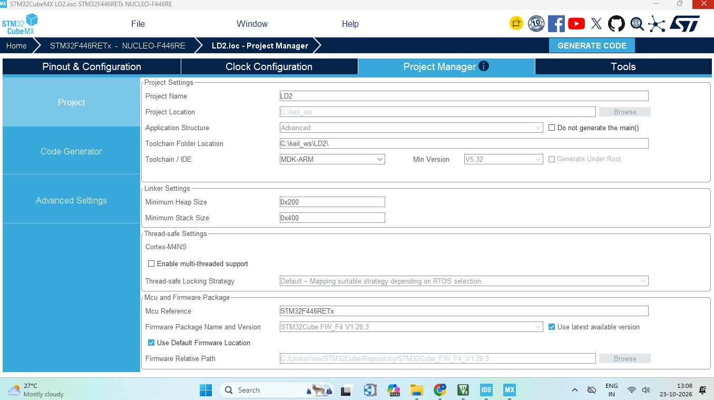
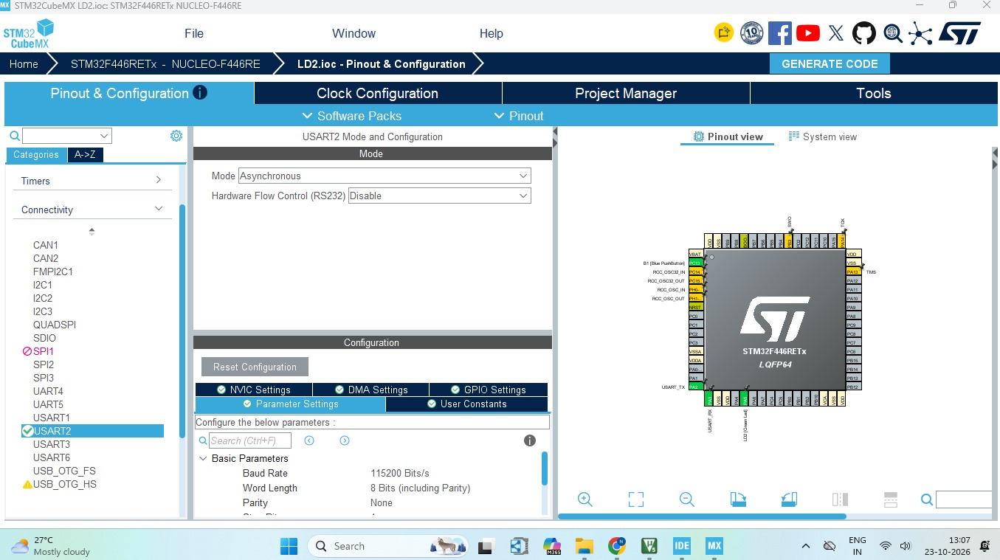
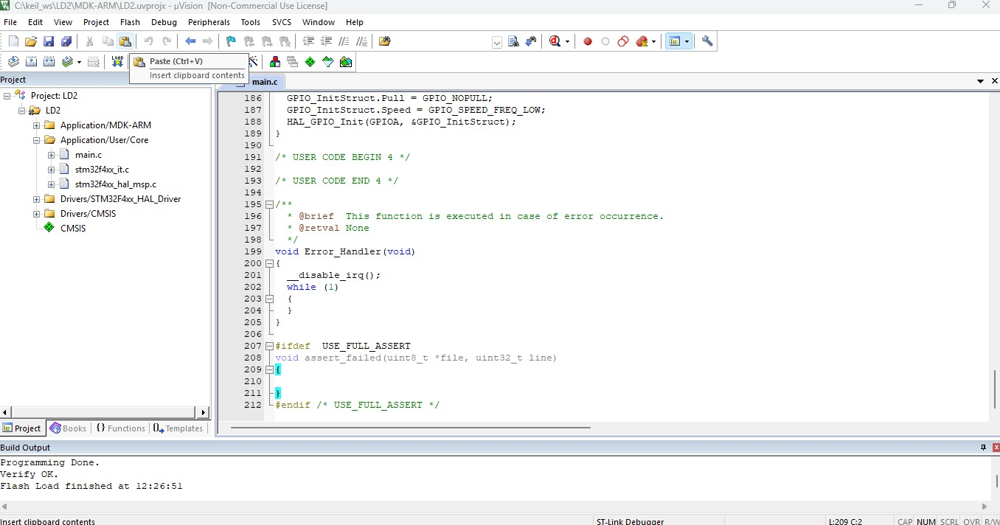
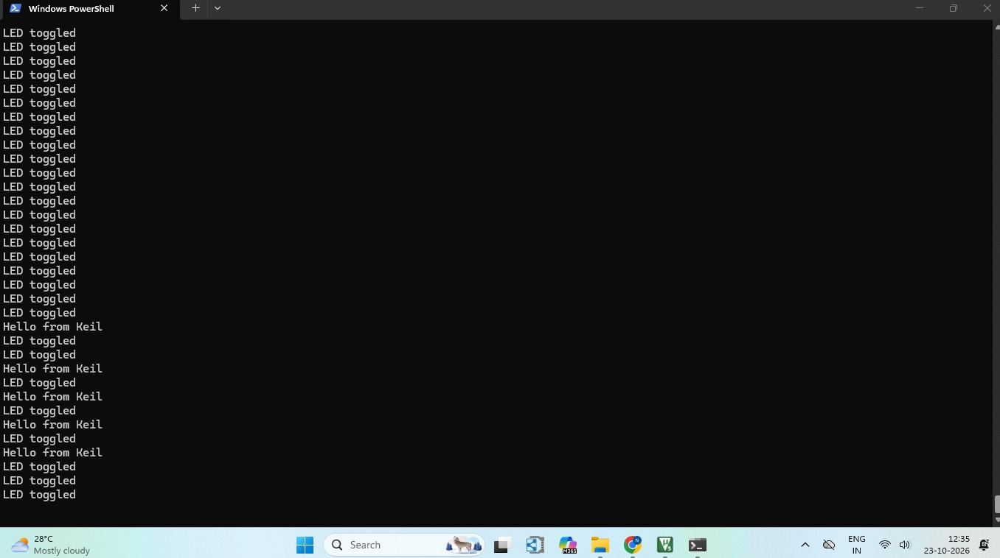
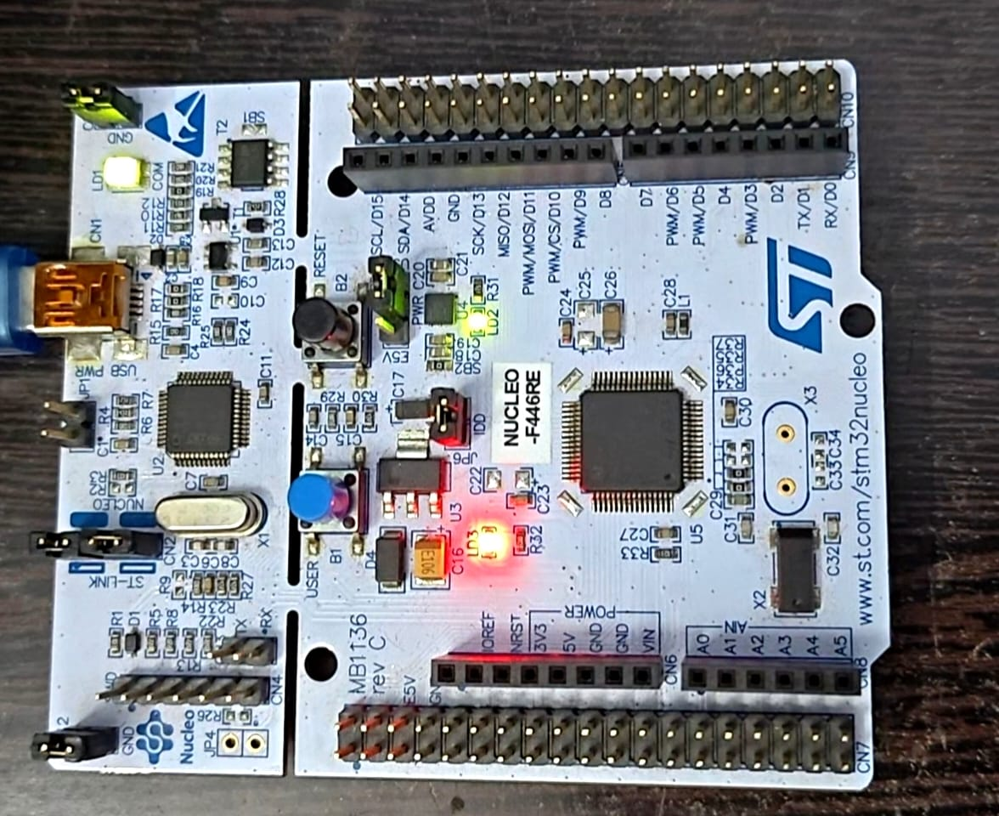

# STM32 NUCLEO-F446RE LED Blink using STM32CubeMX and Keil µVision

## Project Overview

This project demonstrates onboard LD2 LED blinking on the STM32 NUCLEO-F446RE development board using Embedded C. STM32CubeMX is used to configure the GPIO and generate the project code, while Keil µVision is used to build and run the application.

The onboard LED connected to PA5 toggles at one-second intervals using the STM32 HAL library.

## Hardware and Software Requirements

- **Development Board:** STM32 NUCLEO-F446RE
- **Microcontroller:** STM32F446RE
- **Configuration Tool:** STM32CubeMX
- **IDE:** Keil µVision
- **Programming Language:** Embedded C
- **Library:** STM32 HAL

## GPIO Configuration

| Parameter | Configuration |
|---|---|
| LED | Onboard LD2 |
| GPIO Pin | PA5 |
| GPIO Mode | Output Push-Pull |
| Pull-up/Pull-down | No Pull-up and No Pull-down |
| Output Speed | Low |
| LED Toggle Interval | 1 second |

## Project Setup and Implementation

### 1. LD2 Pinout and GPIO Configuration

The onboard LD2 LED is connected to PA5. The pin is configured as a GPIO output in STM32CubeMX.

### 2. STM32CubeMX Project Manager Configuration

Configure the project settings and select Keil MDK-ARM as the toolchain for code generation.

### 3. Generate Code Using STM32CubeMX

Generate the initialization code and project files based on the selected peripheral and project configurations.

### 4. Keil µVision Project Window

Open the generated project in Keil µVision and implement the LED blinking logic in `main.c` using the STM32 HAL functions.

### 5. PowerShell Window
Windows PowerShell can be used to read serial data from the STM32 board through its virtual COM port.
The following command opens COM26 at 115200 baud and continuously reads incoming serial lines.

$p = New-Object System.IO.Ports.SerialPort COM26,115200,None,8,one

$p.Open()

while ($true) { $p.ReadLine() }

Command explanation:

 - COM26 — Serial port assigned to the STM32 board on the computer.

 - 115200 — Serial communication baud rate.

 - None — No parity.

 - 8 — Eight data bits.

 - one — One stop bit.

 - $p.ReadLine() — Reads incoming serial data one line at a time.

Note: Replace COM26 with the actual COM port assigned to your board. The firmware must transmit serial data at 115200 baud for readable output. The LED blinking code alone does not generate serial messages; UART transmission must also be implemented and configured if you want to see output in PowerShell.

### 6. Hardware Output

The following image shows the STM32 NUCLEO-F446RE board with the onboard LD2 LED during the blinking operation.

## Demonstration Video

Watch the demonstration video to see the onboard LD2 LED blinking on the STM32 NUCLEO-F446RE board.

[▶ Watch the LED Blink Demonstration](https://drive.google.com/file/d/1Uio6HuSuMHTh0l28ERQCsCBaXUSfDx5t/view?usp=drivesdk)

## Key Concepts Learned

- STM32 GPIO configuration and control
- STM32CubeMX project configuration and code generation
- Embedded C programming
- STM32 HAL library functions
- System clock configuration
- Building an STM32 project using Keil µVision
- Onboard LED control using `HAL_GPIO_TogglePin()`
- Time delays using `HAL_Delay()`

## Conclusion

This project provides practical experience in STM32 peripheral configuration, automatic code generation, and embedded firmware development using STM32CubeMX and Keil µVision.

It serves as a foundation for future STM32 projects involving GPIO, push buttons, timers, interrupts, and peripheral interfacing.
